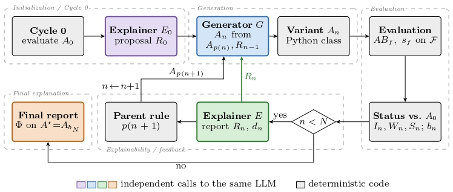

# Toward-Explainable-CMAES-with-LLMs
Official repository for the EvoStar 2027 paper “Toward the Explainable Design of Evolutionary Algorithms with LLMs: A Case Study on CMA-ES,” covering Large Language Models (LLMs), CMA-ES, Explainable Algorithm Design, and Automated Evolutionary Algorithm Design.

  

  <b>Figure 1.</b> Proposed LLM-guided framework for the explainable design of CMA-ES variants.

